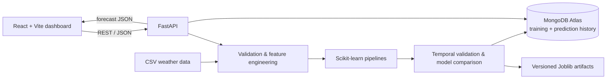

# Localized Climate & Weather Forecast Engine

A full-stack weather ML product that predicts the next hourly temperature, humidity, rainfall, and wind speed for a selected location. It compares three multi-output regression families, persists versioned model artifacts, and tracks performance over repeated training runs.

> **Local storage behavior:** MongoDB Atlas is used when `MONGODB_URI` is configured. Without it, the API logs a warning and uses a process-local adapter so the application can be explored without credentials. In-memory records do not survive a restart and are not appropriate for production.

## Problem and solution

General-purpose forecasts can miss local patterns and provide little transparency about how their models perform. Atmos combines location, observed conditions, lagged and rolling weather features, and calendar context into an auditable training pipeline. Each training run is evaluated on a chronological hold-out set, compared with alternatives, persisted as a new model version, and made visible in the dashboard.

## Architecture



## Project structure

```text
localized-weather-engine/
├── frontend/
│   ├── src/
│   │   ├── components/       # Sidebar, metric cards, Recharts visualizations
│   │   ├── services/         # API client
│   │   ├── App.jsx            # Dashboard and product views
│   │   └── index.css
│   ├── package.json
│   └── vite.config.js
├── backend/
│   ├── app/
│   │   ├── database/          # MongoDB / local adapter
│   │   ├── ml/                # Validation, feature engineering, model training
│   │   ├── models/            # Pydantic request/response schemas
│   │   ├── routes/            # REST API
│   │   └── services/
│   ├── datasets/sample_weather.csv
│   ├── saved_models/          # Generated, versioned Joblib files
│   ├── tests/
│   ├── Dockerfile
│   └── requirements.txt
├── notebooks/
│   ├── data_analysis.ipynb
│   └── model_experimentation.ipynb
├── .env.example
└── README.md
```

## Screenshots

Add portfolio captures after running the dashboard:

- `docs/screenshots/dashboard.png` — overview and model accuracy history
- `docs/screenshots/forecast.png` — location form and forecast result
- `docs/screenshots/training.png` — dataset validation and training history

## ML methodology

- **Forecast horizon:** each observation at time *t* predicts the next row in the chronological dataset (*t + 1*, usually the next hour).
- **Inputs:** latitude/longitude; current observed temperature, humidity, rainfall, wind and pressure; month/day/hour; 24-row previous-day values; and trailing six-observation averages.
- **Targets:** next-observation temperature, humidity, rainfall, and wind speed, trained together as a multi-output regression task.
- **Candidates:** Linear Regression, Random Forest Regressor, and Gradient Boosting Regressor (wrapped with `MultiOutputRegressor`).
- **Preprocessing:** numeric median imputation and standard scaling live inside a scikit-learn `Pipeline`/`ColumnTransformer`, fitted separately in each fold and train split.
- **Validation:** the latest 20% is held out in time order. `TimeSeriesSplit` is used for cross-validation; a bounded grid search tunes Random Forest candidates. The highest hold-out aggregate R² candidate is selected.
- **Metrics:** aggregate MAE, MSE, RMSE and R² plus target-level R²/MAPE, CV R², training time, actual-vs-predicted pairs, residuals, and feature importance.
- **Versioning:** runs receive monotonically increasing `vN` identifiers and distinct `weather_model_vN.joblib` files. History entries are append-only.

The bundled reproducible synthetic series (seed 42) is trained at API startup when no persisted model exists. It is for demonstrating the product and testing the pipeline, not for operational forecasting. The included CSV is a small schema example; use a larger hourly/daily dataset (with at least 12 valid records) for meaningful model performance. Suitable sources include NOAA Integrated Surface Database, NOAA GHCN-Daily, Meteostat, or a licensed local weather station feed. Confirm the source license and normalize units/timezone before use.

## Product features

- Responsive SaaS-style dashboard with overview, forecast, model performance, training history, dataset upload, candidate comparison, and settings views.
- Dark mode toggle, responsive sidebar, busy states, toast feedback, empty states, chart tooltips, model metrics, and charts.
- Location-aware next-hour prediction API and uncertainty estimate based on the 90th percentile absolute hold-out residual per target.
- CSV schema/range validation, dataset preview, missing/duplicate/outlier analytics, and explicit upload-then-retrain workflow.
- Model comparison table and feature importance (Random Forest native importance; coefficient magnitude for Linear Regression).
- Prediction request log and append-only training iterations in MongoDB.
- CORS allowlist, constrained CSV upload, validated inputs, environment configuration, and API error responses.

## API

FastAPI interactive docs are available at `/docs`.

| Method | Endpoint | Description |
|---|---|---|
| `GET` | `/api/health` | Service and model readiness |
| `GET` | `/api/features` | Feature, target, and CSV schema |
| `POST` | `/api/predict` | Predict weather for a location |
| `POST` | `/api/upload-dataset` | Validate and stage a CSV |
| `POST` | `/api/train` | Train staged data, or synthetic demo data |
| `GET` | `/api/model/latest` | Latest model metrics and diagnostics |
| `GET` | `/api/model/history` | Training versions and metric history |
| `GET` | `/api/model/comparison` | Candidate model metrics |
| `GET` | `/api/weather/history` | Recent logged prediction requests |

Example prediction:

```json
{
  "city": "Mumbai",
  "latitude": 19.076,
  "longitude": 72.8777,
  "temperature": 27,
  "humidity": 70,
  "rainfall": 0,
  "wind_speed": 12,
  "pressure": 1013
}
```

CSV required columns: `date, latitude, longitude, temperature, humidity, rainfall, wind_speed, pressure`. Use ISO-8601 timestamps and degrees Celsius, relative humidity %, rainfall mm, wind km/h, and pressure hPa.

## Local development

Prerequisites: Python 3.10+ (3.12 recommended), Node.js 20+, and optional MongoDB Atlas access.

1. Configure the environment from the project root:

   ```bash
   cp .env.example .env
   # Set MONGODB_URI to an Atlas database user URI to persist history.
   # If blank, local in-memory storage is used.
   ```

2. Start the API:

   ```bash
   python -m venv .venv
   source .venv/bin/activate
   pip install -r backend/requirements.txt
   uvicorn app.main:app --app-dir backend --reload --port 8000
   ```

3. Start the dashboard in another terminal:

   ```bash
   cd frontend
   npm install
   npm run dev
   ```

   Open <http://localhost:5173>. API docs: <http://localhost:8000/docs>.

4. Optional frontend API override:

   ```bash
   # frontend/.env.local
   VITE_API_URL=http://localhost:8000
   ```

   Only public API origins belong in frontend environment variables. Keep MongoDB credentials exclusively in the backend environment.

## MongoDB Atlas setup

Create an Atlas cluster and database user; allow the backend's egress IP in Network Access, then copy the connection string into backend `MONGODB_URI` (or root `.env` for local development). The application creates `localized_weather.iterations` and `localized_weather.predictions` collections on first write. Store the URI as a Render secret in production. A MongoDB connection failure is logged and fails startup rather than silently switching to ephemeral storage.

## Testing and build

```bash
cd backend
pytest -q
cd ../frontend
npm run build
```

Tests cover feature engineering, input schema validation, and coordinate bounds. The default 240-observation deterministic synthetic sequence allows a local API smoke test without an external weather provider.

## Deployment

### Backend — Render

Create a Render Web Service from this repository, set **Root Directory** to `backend`, **Dockerfile Path** to `Dockerfile`, and provide:

- `MONGODB_URI`: Atlas URI
- `MODEL_PATH`: `/app/saved_models`
- `CORS_ORIGINS`: exact Vercel frontend origin
- `MAX_UPLOAD_MB`: upload limit, default `10`

Run health checks against `/api/health`. For durable model artifacts, attach a persistent disk at `/app/saved_models` or use an artifact/object store in a multi-instance deployment; MongoDB holds metrics and model version metadata, not binary artifacts.

### Frontend — Vercel

Import the repository, set project root to `frontend`, use the Vite preset, and set `VITE_API_URL` to the deployed backend origin. Add that exact origin to backend `CORS_ORIGINS`, then redeploy the backend.

### GitHub

```bash
git init
git add .
git commit -m "Build localized weather forecast engine"
git branch -M main
git remote add origin https://github.com/<your-user>/localized-weather-engine.git
git push -u origin main
```

Do not commit `.env`, MongoDB URIs, or production credentials. Add `Co-authored-by` only where your contribution policy requires it.

## Limitations and next steps

The demonstration model learns from synthetic or user-supplied observations and does not call a third-party geocoder or live weather provider. Coordinates influence the regression, but location coverage depends on representative training data. Production improvements should add geospatially diverse validated data, station/source provenance, timezone-aware resampling, deployment artifact storage, auth and role-based training access, background training jobs, drift monitoring, forecast calibration, and integration tests against a temporary MongoDB instance.
